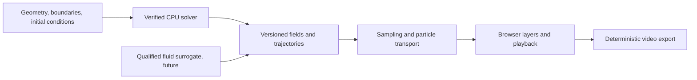

# Fine fluid and particle viewer: implementation plan

Status: deferred final phase, 29 October 2026, by user direction. Primary fluid
physics, reference qualification, datasets and learned-model deliverables take
priority. This document preserves the design; it does not authorize active viewer
work ahead of those gates. No interactive viewer is implemented here.

## Reference audit and limits

The [local video and repository review](viewer_reference_review.md) supersedes the
initial title-only audit. Six downloaded clips were inspected using 126 sampled
frames, including short temporal sequences. All three supplied repository trees
were inventoried and their relevant fluid/rendering source paths reviewed at
pinned commits. Evidence manifests and contact sheets are retained under
`outputs/reference_review_20261029/`.

The inspected configurations are a MATLAB particle jet, Kutta's animated wing,
Energy2D temperature plumes, stacked airfoil comparisons, and PERRINN's moving
rear-wing section. PERRINN is confirmed OpenFOAM **2D** overset-mesh flow, despite
its 3D introduction. The Aero-Shifted clip's Fluent attribution and the exact
NACA 4412 preset remain unverified. These six files do not establish coverage of
all eight original YouTube references; the smoke clip is not among the local files.

Adapt emitter, trail, layout and export techniques from the reviewed sources.
Keep solver validation independent: Kutta is explicitly qualitative, and
Spectrometry's frozen-field tails must not be labeled recorded particle histories.

The [creator's smoke repository](https://github.com/SebLague/Smoke-Simulation)
is a useful implementation reference. Its Unity implementation is not a dependency
decision for PhysGraph. Inspect actual clips or supplied recordings before freezing
the visual specification for the remaining references, including whether they
require free surfaces, 3D, combustion, moving solids or particular camera effects.

The creator's [CPU fluid implementation](https://github.com/SebLague/Smoke-Simulation/blob/main/Assets/SmokeCPU/FluidGrid.cs)
was also inspected: it separates staggered velocity components, pressure, solid
cells and a smoke scalar, with pressure correction and backtraced advection.
Its [drawing code](https://github.com/SebLague/Smoke-Simulation/blob/main/Assets/SmokeCPU/FluidDrawer.cs)
offers dye, speed, pressure and divergence modes plus velocity arrows and input
interaction. These are verified source-code observations, not observations of
the video's motion or visual quality.

## Why the current motion looks coarse

`configs/experiments/periodic_flow.json` requests a 32 x 32 velocity grid, 100
passive tracers, dt=0.01, 200 steps and a saved frame every five steps. That produces
41 states over two physical seconds. `visualization/flow.py` draws small black
points over a vorticity image in a 6-inch Matplotlib figure and writes a 15 fps GIF.
There are no trails, emitters, zoom controls or display-time interpolation.

These are independent limitations:

- Sparse marks: 100 particles poorly communicate a whole flow field.
- Sparse playback: saved times are 0.05 physical seconds apart. At 15 fps the
  apparent advance is 0.75 physical seconds per wall-clock second, rather than 1x.
- Spatial sampling: particle velocities use bilinear interpolation on the numerical
  grid. More particles do not increase the resolved velocity detail.
- Physics: the verified examples are smooth periodic Taylor-Green/shear flows.
  Increasing image resolution cannot create obstacle wakes, jets or turbulence.

Retain this small GIF as a numerical smoke check. Build the viewer against the
timestamped trajectory/field artifacts, rather than deriving motion from GIF frames.

## Architecture and scientific contract

Keep simulation timestep, particle integration timestep, saved-state cadence and
display refresh separate. Render against physical timestamps and an explicit
playback speed. Browser refresh should use timestamp-based
[requestAnimationFrame](https://developer.mozilla.org/en-US/docs/Web/API/Window/requestAnimationFrame);
the same trajectory must take the same time at 30, 60 or 120 Hz. Background-tab
resumption must not trigger an unbounded simulation catch-up loop.

Start with local browser Canvas 2D playback and a worker for parsing/sampling.
Benchmark it before selecting an optional WebGL renderer for larger particle
counts. A graphics backend does not require CUDA or GPU model training. Any GPU
phase still needs the repository's hardware, precision, timing and memory report.
Do not replace the verified Python solver with an unvalidated browser simulation.

Use a manifest plus chunked typed binary arrays for browser delivery; retain NPZ
as the scientific archive. Record units, coordinate convention, mesh/connectivity,
boundary tags, time array, field locations/order, precision, solver/source identity,
seeds and checksums. Preserve high-order velocity interpolation when using a
high-order FEM reference; a nodal P1 display conversion needs its own error check.
Cap the playback cache and export frames incrementally. For scale, 10,000 particle
positions at 600 frames require about 48 MB in float32 before metadata or fields;
storing every dense field at display cadence can dominate memory.

Reference, interpolated display and neural fields must retain their provenance.
Visual refinement must not overwrite FEM/reference data or fabricate physical
eddies. Frame interpolation is permitted only within tested temporal error bounds.

## Deliverables in dependency order

| Milestone | Concrete deliverable | Acceptance before advancing |
| --- | --- | --- |
| V1: smooth replay | Local viewer for current periodic artifacts; play/pause, scrub, speed, zoom, field legend and physical time; periodic seam-safe trajectories; standalone 1080p frame export | Same physical state at a chosen time across refresh rates; no line across a periodic seam; export duration matches requested speed; fields agree with archive samples |
| V2: dense flow depiction | Deterministic 2,000 then 10,000 tracer presets; connected fading trails, point/line emitters, adjustable lifetime/width/opacity; speed/vorticity coloring; separate streamline/pathline/streakline modes | Particle convergence under timestep and sampling refinement; no invented displacement on scrub/reseed; repeatable seeds; p95 frame time <=16.7 ms at the declared 60 fps benchmark target or honestly report a lower supported tier |
| V3: dye/smoke | Scalar advection-diffusion with declared diffusivity and sources, bounded transport, multiple dye channels; opacity mapping and independent layer controls | Constant-field and manufactured transport tests; mass balance with sources/fluxes accounted for; boundedness and mesh/time refinement; density is not confused with vorticity |
| V4: fixed geometry flow | Tagged imported triangle meshes; Stokes first, then transient incompressible velocity/pressure; channel, cylinder wake, then airfoil cross-section presets | Valid positive-area meshes and complete BC tags; pressure gauge fixed; no-slip/nonzero inflow checks; divergence and flux balance; independently reproduced benchmark forces and refinement |
| V5: arbitrary supported 2D inputs | Closed contours/meshes with holes, robust point location, near-wall resolution, particle inlet/outlet/wall policies; full UI configuration and probe comparison | Reject self-intersections/missing BCs; no invalid particle traversal; parameter/geometry coverage declared; solve-to-export integration checks |
| V6: accelerated prediction | Transient vector/pressure datasets, time-aware fluid GNN, reference-versus-prediction viewer, validity checks and CPU reference fallback | Held-out geometries, Reynolds numbers and rollout horizons; velocity/pressure/force/trajectory errors; divergence, drift and stability; measured end-to-end speedup |

V1/V2 are technically independent of GNN qualification, but are deferred by the
current project priority. V3 on the periodic domain
does not need V4; V3 coupled to walls and emitters at inlets does. V4 starts with
offline CPU simulation and responsive playback. A 60 fps viewer does not promise
60 physical solver updates per second or immediate recomputation after changing BCs.

The proposed 1080p/60 fps and particle counts are engineering targets, not measured
performance claims. Record CPU, browser, viewport, device pixel ratio, particle
count, trail segments, field resolution, p50/p95 frame time and peak memory.
Reduce display density before degrading physical timestep or numerical tolerances.

## Motion, trails and sampling details

- Integrate dX/dt = u(X,t) with controlled substeps. The existing RK4 reference is
  useful; choose step sizes using local cell size, velocity and boundary events.
  RK4 alone cannot correct inaccurate spatial or temporal velocity interpolation.
- On the periodic grid, interpolate in unwrapped coordinates, split trails at
  periodic seams and then map to screen coordinates. Do not connect opposite
  screen edges or interpolate wrapped coordinates through the box interior.
- For saved velocity fields, refine output cadence and compare reconstructed
  paths with trajectories integrated alongside the solver. Linear interpolation
  is the initial transparent baseline; higher-order interpolation requires tests
  for overshoot and near-boundary behavior before use.
- On triangles, use an acceleration structure plus neighbor walking/barycentric
  location; evaluate the actual FEM velocity basis. A candidate particle segment
  must be checked for solid intersections. Substep/reject invalid crossings and
  document outlet termination and inlet reseeding. Do not bounce passive tracers
  as if they were colliding solid particles.
- A streamline freezes u at one time; a pathline follows one particle over time;
  a streakline joins particles released from one source at different times. These
  differ in unsteady flow and must be labeled correctly.
- Retain trails by physical age, rather than a fixed count of display frames.
  Reset/reconstruct trails on scrubbing. Smooth taper and antialiasing are display
  operations; adding random motion is a change to the particle model.

## Physics needed for the reference configurations

For geometry-based airflow, use incompressible Navier-Stokes with specified
density, viscosity, boundary and initial data:

    rho (u_t + (u . grad) u) = -grad(p) + mu Delta(u) + f,
    div(u) = 0.

The new discretization should start with an inf-sup stable velocity/pressure
reference, such as P2/P1 Taylor-Hood, with a manufactured Stokes case before
transient nonlinear flow. Keep the existing verified periodic solver as a separate
reference. The [FEniCSx Navier-Stokes tutorial](https://jsdokken.com/dolfinx-tutorial/chapter2/navierstokes.html)
provides channel and cylinder examples and explains pressure-correction boundary
terms. Reproduce a precisely identified benchmark with its stated BCs and regime;
do not compare a different inflow or Reynolds number against its quoted forces.

The inspected DRS motion requires a later moving-boundary branch: prescribed wing
motion, moving-wall velocity and ALE/remeshing or a verified immersed-boundary
method. Changing a drawn mask is not sufficient. A 2D wing section is a useful
first deliverable but does not reproduce full-car 3D wake/endplate physics.

For dye, add the explicitly formulated transport equation

    c_t + u . grad(c) = kappa Delta(c) + s,

with initial/boundary data and manufactured cases. A passive smoke-looking dye is
the first mode. Buoyant smoke additionally needs temperature/density coupling and
a documented Boussinesq approximation; combustion/fire is a separate model.
Avoid artificial vorticity confinement in the scientific reference; if later
offered for visual exploration, mark and quantify it as a modified model.

If the unviewed references contain splashing liquids, they require a free-surface
method (for example a separately verified FLIP/APIC or interface-tracking branch),
not denser passive particles. Matthias Müller's
[Eulerian and FLIP tutorials](https://matthias-research.github.io/pages/tenMinutePhysics/index.html)
are primary implementation references for these distinct methods. His
[browser wind-tunnel demo](https://matthias-research.github.io/pages/tenMinutePhysics/17-fluidSim.html)
is useful for interaction ideas, not independent CFD validation.

## Immediate build checklist

- [x] Review six supplied local clips and the three linked fluid/rendering repositories; record provenance and reuse decisions.
- [ ] Resolve the remaining original-video coverage and exact Fluent/NACA preset provenance.
- [ ] Specify and validate the browser trajectory/field contract.
- [ ] Implement V1 periodic replay and seam-safe interpolated trajectories.
- [ ] Add deterministic export with explicit physical time and playback rate.
- [ ] Add V2 dense seeding/trails and measure the performance envelope.
- [ ] Verify field/particle sampling refinement before raising solver resolution.
- [ ] Formulate and test dye transport; build V3.
- [ ] Establish the Stokes/velocity-pressure reference; then build V4/V5.
- [ ] Qualify a fluid-specific surrogate before enabling V6.

The current steady scalar elliptic GNN is not a fluid-motion surrogate, even if
its new scalar accuracy study passes. It is not a prerequisite for a useful fine
viewer driven by numerical reference data.
